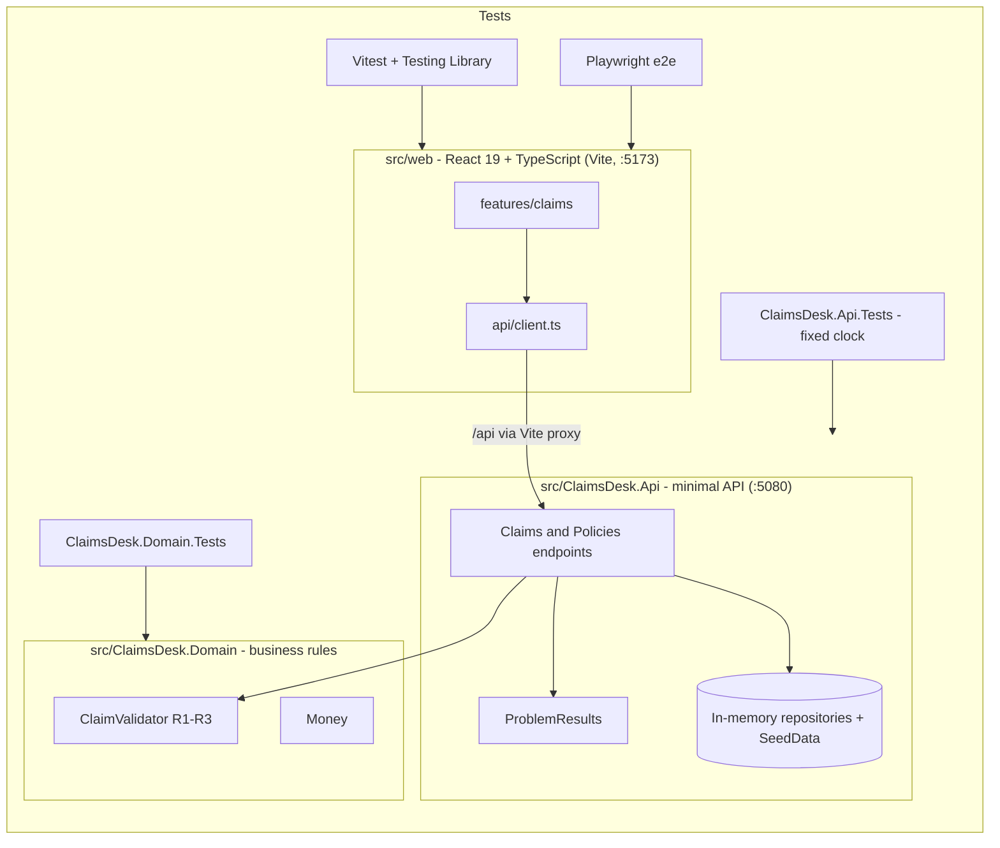

# Architecture

## Endpoints (baseline)

| Method | Route | Result |
|---|---|---|
| GET | `/api/claims?status=<ClaimStatus>` | Claim summaries, newest first |
| GET | `/api/claims/{claimId}` | Claim detail (no claimant email - R9) or 404 `CLAIM_NOT_FOUND` |
| POST | `/api/claims` | 201 with the new claim, or 400 problem details with `errors[]` codes |
| GET | `/api/policies`, `/api/policies/{policyNumber}` | Policies, or 404 `POLICY_NOT_FOUND` |
| GET | `/health` | Health check |
| GET | `/openapi/v1.json` | OpenAPI document (Development only) |

JSON is camelCase with string enums; dates are `yyyy-MM-dd`; money is a JSON number in GBP.

## Data

Seed data is generated relative to **today**, so the demo never ages: 6 policies (Home, Motor, Travel; one Lapsed, one
Cancelled) and 12 claims covering every rule outcome. Tests pin the clock to 2026-11-02 so ids are `CLM-2026-0001` to
`CLM-2026-0012`. See the `claims-rules` skill for worked examples.

## What the stories add

| Story | Adds |
|---|---|
| CLM-100 | `SettlementCalculator` (R4) and `estimatedSettlement` on the claim detail |
| CLM-101 | `TriageRules` (R5-R7), `triage` on the claim detail, a triage badge in the web app |
| CLM-102 | `daysOpen` on the claims list (R10) and a "Days open" column with an overdue marker |

## Design choices worth pointing at

- **Rules in the domain** (pure C#, explicit inputs such as `today`) - easy for people and Copilot to test.
- **TimeProvider** everywhere - deterministic tests and no hidden clock.
- **Problem details with codes** - stable error contract for the web app and tests.
- **Contract mirrored in `types.ts`** - one place per side, changed together.
- **No AI in CI** - agents author and review; pipelines run deterministic checks.
